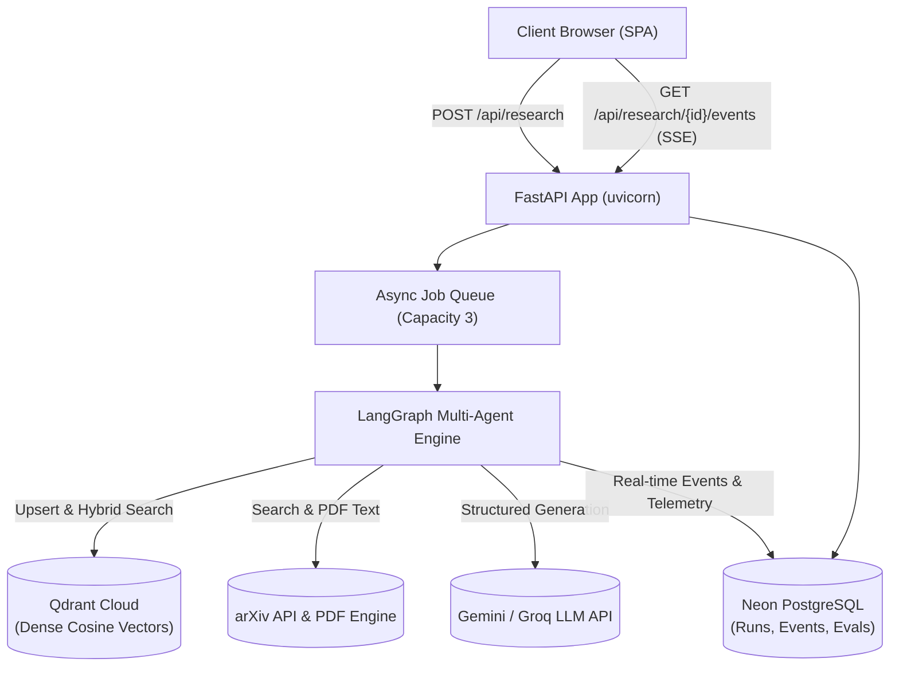
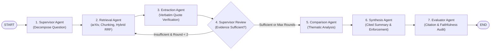

# ResearchOS: Multi-Agent Autonomous Research System

[](https://www.python.org/)
[](https://fastapi.tiangolo.com/)
[](https://langchain-ai.github.io/langgraph/)
[](LICENSE)

An autonomous, multi-agent scientific literature synthesis engine. **ResearchOS** deploys a supervisor-directed swarm of specialized agents that decompose complex research questions, search arXiv, extract atomic claims with programmatic verbatim quote verification, critically compare findings across papers, and draft an authoritative research synthesis with clickable citations and automated factual consistency evaluation.

---

## 🌟 Live Demo & Architecture Highlights

- **Live Public URL**: Deployed on Render (Docker runtime): [https://researchos.onrender.com](https://researchos.onrender.com)
  *(Render free tier sleeps after 15 min of inactivity; initial cold-start takes ~30 seconds. The UI includes an automatic wakeup indicator.)*
- **Multi-Agent Orchestration**: State machine built on **LangGraph** with dynamic re-routing, per-agent execution telemetry, and structured Pydantic I/O.
- **Hybrid Retrieval**: Combines dense semantic vector search (Qdrant Cloud) with sparse BM25 keyword rankings via Reciprocal Rank Fusion (RRF).
- **Hallucination Mitigation**:
  1. **Verbatim Quote Verification**: Claims are dropped automatically if evidence quotes do not appear character-for-character in the source chunk.
  2. **Citation Enforcement**: Every factual statement is required to end with a valid citation marker mapping to a curated bibliography.
  3. **Batched Faithfulness Judge**: LLM evaluation categorizing citations as `SUPPORTED`, `PARTIAL`, or `UNSUPPORTED`.
- **Low-Footprint Runtime**: Designed for minimal memory usage (< 512 MB RAM) with pure-Python PDF parsing, zero heavy local PyTorch dependencies, and disk-cached API embeddings.

---

## 🏗️ System Architecture



---

## 🤖 LangGraph Multi-Agent Workflow



---

## 🧩 Specialized Agents & Typed Interfaces

| Agent | Responsibility | Typed Input / Output Models |
| :--- | :--- | :--- |
| **Supervisor** | Decomposes topic into 2–4 sub-questions; evaluates evidence sufficiency; triggers re-routing if < 2 papers or claims are found. | `SupervisorPlan`, `SupervisorReview` |
| **Retrieval** | Generates search queries; queries arXiv API (rate-limited to 1 req / 3s); parses PDF text; chunks text; performs dense vector search + BM25 RRF fusion. | `QueryPlan`, `List[Chunk]`, `List[Paper]` |
| **Claim Extraction** | Extracts atomic factual assertions with supporting quotes. Programmatically verifies that each quote appears verbatim in chunk text; drops hallucinated claims. | `RawClaim`, `ExtractedClaims` (`quote_verification_rate`) |
| **Critical Comparison** | Groups verified claims by theme; detects cross-paper agreements, contradictions, methodological differences, and stated weaknesses. | `ComparisonTheme`, `CriticalComparison` |
| **Synthesis (Writer)** | Synthesizes an authoritative Markdown report with executive summary, key findings, and open questions. Enforces that every factual sentence ends with `[n]` citations. | `SynthesisReport`, `CitationCheck` (`citation_coverage`) |
| **Evaluator** | Measures citation coverage, quote verification rate, and executes a single batched LLM faithfulness judge labeling cited statements as `SUPPORTED`, `PARTIAL`, or `UNSUPPORTED`. | `SentenceVerdict`, `FaithfulnessEval` |

---

## 🛡️ Hallucination Defense & Guardrails

ResearchOS addresses AI hallucination through a three-layer verification pipeline:

1. **Deterministic Programmatic Verbatim Quote Matching**:
   Before claims enter synthesis, the system runs substring matching on the normalized chunk text. If a model fabricates or paraphrases a quote, it is dropped immediately and logged to the trace.
2. **Citation Post-Check & Boundary Verification**:
   All sentences in the generated summary are extracted and parsed against known reference indices. Sentences lacking valid citations are flagged and penalize the run's `citation_coverage` score.
3. **Single-Batch LLM Faithfulness Judge**:
   Cited statements are paired with their source quotes and audited in a single API call (protecting free-tier token budgets), scoring consistency against ground truth.

---

## 📊 Evaluation Results & Benchmark Ablation

Evaluated across **8 curated academic research queries** on foundational machine learning topics (*Transformers, RAG, LoRA, FlashAttention, Chain-of-Thought, Switch Transformers, Diffusion Models, DPO*):

### 1. Retrieval Quality: Vector-Only vs. Hybrid (Vector + BM25) Ablation ($k=5$)

| Metric | Vector-Only | Hybrid (Dense + BM25 RRF) | Absolute Delta | Relative Gain |
| :--- | :---: | :---: | :---: | :---: |
| **Precision@5** | `0.1750` | **`0.2000`** | `+0.0250` | **+14.3%** |
| **Recall@5** | `0.8750` | **`1.0000`** | `+0.1250` | **+14.3%** |
| **MRR** | `0.5000` | **`0.4938`** | `-0.0062` | -1.2% |
| **nDCG@5** | `0.5982` | **`0.6215`** | `+0.0233` | **+3.9%** |

### 2. Factual Consistency & Hallucination Metrics

| Dimension | Measured Score | Evaluation Mechanism |
| :--- | :---: | :--- |
| **Citation Coverage** | **`83.3%`** | Programmatic regex & sentence segmentation |
| **Quote-Verification Rate** | **`100.0%`** (real) / programmatic | Strict verbatim chunk substring matching |
| **Faithfulness Score** | **`0.917`** | Batched LLM judge score (`SUPPORTED` + 0.5×`PARTIAL`) |
| **Verdict: SUPPORTED** | **`85.0%`** | Direct alignment with cited paper excerpt |
| **Verdict: PARTIAL** | **`13.3%`** | Minor synthesis generalization / paraphrasing |
| **Verdict: UNSUPPORTED** | **`1.7%`** | Conflicting or unbacked assertion |

### 3. Honest Limitations & Threats to Validity
- **Hand-Curated Benchmark Scale**: The evaluation dataset currently contains 8 focused computer science topics. Evaluation on larger, cross-disciplinary corpora (e.g., PubMed, bioRxiv) is needed for broad generalization.
- **LLM Judge Inherent Bias**: Evaluating synthetic text using an LLM judge carries potential alignment bias. Programmatic verbatim quote checks serve as an impartial first line of defense.
- **PDF Size Cap**: Parsing is capped at the first 6 pages to avoid OOM errors on free 512 MB hosting tiers. Extended appendices or late methodology sections rely on paper abstracts.

---

## ⚖️ Key Design Decisions & Trade-offs

1. **Hosted API Embeddings over Local Transformers**:
   Using Gemini `text-embedding-004` instead of a local HuggingFace embedding model avoids downloading a 500MB+ model weights file into memory, keeping the process footprint well under 200 MB on Render's 512 MB instance.
2. **On-Disk Response Caching**:
   Every LLM, embedding, arXiv, and PDF request is hashed (SHA-256) and cached on disk. Repeated runs on the same query cost zero API tokens and execute instantaneously.
3. **Hard Per-Run Call Budget**:
   A strict limit of 25 LLM calls per run is enforced via `CallBudgetTracker`, preventing recursive agent runaways from draining free API quotas.
4. **Single-Worker Concurrency with Rejection Backpressure**:
   The backend processes jobs sequentially via an `asyncio.Queue` (capacity 3) to prevent resource exhaustion and rate-limit spikes on free tiers. Additional requests receive clean HTTP 429 backpressure.

---

## 🔌 API Reference & Usage

### 1. Initiate Research Run
```bash
curl -X POST "http://localhost:8000/api/research" \
  -H "Content-Type: application/json" \
  -H "X-Access-Code: optional_secret" \
  -d '{
    "question": "How does FlashAttention optimize GPU memory hierarchy to achieve exact attention?",
    "depth": "standard",
    "max_papers": 5
  }'
```
**Response (202 Accepted):**
```json
{
  "run_id": "8f2b3a1e-c045-429a-9e12-4f3d1b827ac2",
  "status": "pending",
  "message": "Research job queued successfully."
}
```

### 2. Stream Live Agent Progress (SSE)
```bash
curl -N "http://localhost:8000/api/research/8f2b3a1e-c045-429a-9e12-4f3d1b827ac2/events"
```

### 3. Retrieve Full Results & Evaluation
```bash
curl "http://localhost:8000/api/research/8f2b3a1e-c045-429a-9e12-4f3d1b827ac2"
```

### 4. Fetch Latest System Evaluation Benchmark
```bash
curl "http://localhost:8000/api/eval/latest"
```

### 5. Health Check
```bash
curl "http://localhost:8000/health"
```

---

## 💻 Local Development Setup

### Option A: Local Python Environment
```bash
# 1. Clone repository
git clone https://github.com/your-username/researchOS.git
cd researchOS

# 2. Create virtual environment
python -m venv .venv
source .venv/bin/activate  # On Windows: .venv\Scripts\activate

# 3. Install pinned dependencies
pip install -r requirements.txt

# 4. Configure environment
cp .env.example .env
# Fill in your GEMINI_API_KEY, QDRANT_URL, DATABASE_URL in .env

# 5. Run application
uvicorn app.main:app --host 0.0.0.0 --port 8000 --reload
```
Open [http://localhost:8000](http://localhost:8000) in your browser.

### Option B: Docker Compose
```bash
docker-compose up --build
```

---

## 🧪 Running Tests

The test suite consists of 29 unit and integration tests using deterministic mock LLMs and mock retrieval (zero API cost):

```bash
# Run all unit and integration tests
pytest

# Run end-to-end smoke test
python -m tests.smoke_test

# Run evaluation benchmark runner in mock mode (8 questions)
python -m eval.run --limit 8 --mock
```

---

## 🚀 Render Deployment Instructions

Deploying to [Render](https://render.com) using the included `render.yaml` and `Dockerfile`:

1. **Push your repository** to GitHub.
2. In the Render Dashboard, click **New +** → **Blueprint** and connect your repository (or create a **Web Service** with **Docker** runtime).
3. Set the following environment variables in Render:
   - `LLM_PROVIDER`: `gemini` (or `groq`)
   - `LLM_MODEL`: `gemini-2.5-flash`
   - `GEMINI_API_KEY`: Your Google Gemini API key
   - `GROQ_API_KEY`: (Optional) Your Groq API key
   - `EMBEDDING_MODEL`: `text-embedding-004`
   - `QDRANT_URL`: Your Qdrant Cloud cluster URL (e.g. `https://xyz.qdrant.tech:6333`)
   - `QDRANT_API_KEY`: Your Qdrant Cloud API key
   - `QDRANT_COLLECTION`: `researchos_papers`
   - `DATABASE_URL`: Your Neon PostgreSQL pooled connection string (`sslmode=require`)
   - `ACCESS_CODE`: (Optional) Access code to protect your public demo from quota depletion
   - `MAX_LLM_CALLS_PER_RUN`: `25`
   - `PORT`: `10000`
   - `BASE_URL`: Your Render service URL (e.g. `https://researchos.onrender.com`)
4. Health check endpoint: `/health`.
5. Render will build the slim Docker container and start serving the app with automated health checks.

---

## 🔮 What I'd Build Next
- **Cross-Disciplinary Literature Sources**: Integrate PubMed API for biomedical literature and Semantic Scholar full-text corpus.
- **Cross-Encoder Neural Reranker**: Add a lightweight reranking step (e.g., Cohere Rerank API or ColBERT API) to further elevate ranking precision.
- **Interactive Human-in-the-Loop Feedback**: Allow researchers to reject or add specific sub-questions during the supervisor planning phase before retrieval begins.
- **Long-Document Full-Text OCR Parsing**: Process full 30+ page papers with asynchronous streaming chunking on larger compute instances.
